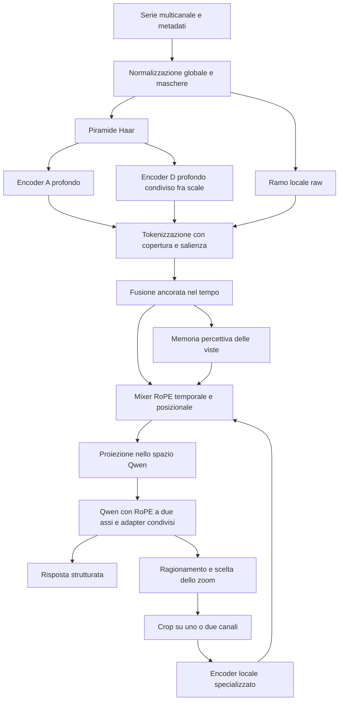

# Wavelet-RoPE Agent: design del prototipo completo

**Versione:** 0.3 — 13 settembre 2026; architettura unica con wildcard temporale fra testo e segnale.  
**Stato:** specifica da implementare; valori progettuali iniziali, non risultati sperimentali.  
**Ambito:** una sola architettura fissata, identificata come **WR-Agent-4B-Wildcard-v1**, con due modalità operative. Le alternative sono esclusivamente in [ABLATION.md](ABLATION.md). Questo documento e `prototype.spec.json` definiscono il modello da implementare; non contengono un menu di architetture.

## 1. Decisione e obiettivo

Costruire un unico modello che possa:

1. leggere la rappresentazione globale multicanale e rispondere direttamente;
2. ragionare sull'evidenza disponibile, scegliere nuove finestre e canali, ricevere rappresentazioni locali più dettagliate, aggiornare l'ipotesi e rispondere.

Entrambe le modalità usano gli stessi pesi finali. Cambiano il protocollo di generazione e l'accesso allo strumento di osservazione. Non occorrono due LLM, né un agente testuale separato che interroghi un TSLM indipendente.

La proposta scientifica è: **una rappresentazione wavelet che apprende la struttura dei segnali prima di comprimerli, conserva una geometria temporale esplicita e può essere interrogata progressivamente dallo stesso LLM.**

I due requisiti obbligatori entrano nel modello effettivo:

- **RoPE temporale/posizionale:** rotazione delle query e delle key nell'attenzione percettiva e nella full attention di Qwen. Nel mixer si divide al 50/50 l'intera testa; in Qwen il sottospazio già rotativo. Non basta aggiungere feature sinusoidali agli embedding.
- **Chain of thought agentica:** segmenti di ragionamento generati prima delle decisioni e dopo le osservazioni, appresi con traiettorie SFT; le osservazioni nuove possono cambiare l'azione successiva e la risposta.

La nuova RoPE opera in due sedi: **nel mixer percettivo**, per collegare coefficienti e osservazioni, e **nella full attention del backbone Qwen**, per mantenere un contributo di attenzione riferito al tempo del segnale anche quando la CoT separa i blocchi numerici. I soft token TS hanno il tempo assoluto dell'ancora nella registrazione; il testo ha una **wildcard di modalità**, non un tempo numerico. La regola del §7.4 conserva la rotazione nativa nelle coppie testo–testo, usa tempo relativo nelle coppie TS–TS e contenuto senza fase temporale nelle coppie miste. Il comportamento multimodale richiede adattamento. Le scelte precedenti sono confronti futuri in [ABLATION.md](ABLATION.md), non opzioni della run principale.

## 2. Cosa sappiamo del sistema attuale

### 2.1 Architettura verificata nel codice

In [wavelet_encoder.py](../kaggle/patch/wavelet_encoder.py), la decomposizione è fissa, Haar per default; `db4` è già disponibile. Il budget standard è 256 token per canale. L'encoder seleziona coefficienti e applica a ciascuno lo stesso `Linear → GELU → Linear`, con dimensione interna/uscita 512, feature Fourier di posizione e embedding di banda.

Il proiettore successivo, nella classe `MLPProjector` di [chatts.py](../timerlm/sft/tslm/src/models/chatts.py), usa `LayerNorm → Linear → GELU → Dropout`. Non realizza interazione fra coefficienti. L'LLM può mescolare i token ricevuti, ma la selezione ha già scartato parte del segnale.

Quindi «oggi c'è solo un MLP» è un'abbreviazione: **il percettore ha un MLP per coefficiente e un proiettore; manca un'elaborazione appresa dei vicini prima della selezione**. Rendere più profondo soltanto il proiettore non corregge questo limite.

La variante [v3-recurrent](../v3-recurrent/README.md) è un'ablazione architetturale del **Livello 1**, non il Livello 3. L'[audit del contesto](../v3-recurrent/AUDIT-CONTEXT-20260908.md) documenta la perdita di diversità del ramo ricorrente. Il nuovo progetto non ripropone quel resampler ricorrente globale con un bypass dominante.

### 2.2 Risultati che orientano il nuovo disegno

Le evidenze aggiornate sono in [RISULTATI-Z1BIS](../l3/RISULTATI-Z1BIS.md) e [RISULTATI-SELETTORI](../l3/RISULTATI-SELETTORI.md).

| Evidenza osservata | Conseguenza progettuale |
|---|---|
| Z1 sfruttava l'anomalia quasi sempre al centro del crop | Posizione interna casuale, negativi e controlli del contenuto; le coordinate dell'header devono essere vere, non eliminate per principio |
| Z1-bis recupera sensibilità al contenuto | Il problema non è l'impossibilità di leggere i coefficienti: rappresentazione e training possono incidere |
| W1 migliora operativamente, ma sui crop identici perde circa 0,030; il calo più forte è multicanale | Allenare e monitorare separatamente percezione locale e scelta delle azioni, con replay percettivo e confronti fra canali |
| Più contenimento tramite crop più larghi non basta con 256 token | Aumentare la densità locale e consentire osservazioni successive; non scambiare copertura per informazione preservata |
| La finestra oracle dipendeva dall'ampiezza scelta dalla policy | Confrontare il lettore su crop identici; non chiamare quelle misure un limite superiore |

Sul confronto W1–Z1-bis a tre crop per ID: Δ lettura = −0,0299, CI95 [−0,0511; −0,0083]; Δ contenuto W1 = +0,1053, CI95 [+0,0798; +0,1319]. Le differenze sono aggregate dentro ciascun ID e il bootstrap usa gli ID. Questo sostiene una regressione media di lettura, non una perdita completa della percezione né una prova che la regressione superi 0,05.

**Nessun valore oracle già misurato, incluso un primary vicino a 0,4, è un ceiling intrinseco.** Dipende da rappresentazione, crop, checkpoint, categorie e scoring. Questa proposta mira a migliorare quelle condizioni; non prevede un punteggio futuro.

## 3. Confine rispetto ai paper ETH

Il messaggio non identifica univocamente il primo articolo. Il repository usa un'interfaccia in stile ChatTS, ma questo non prova che il primo PDF ETH fosse ChatTS. I riferimenti vanno distinti:

- **ChatTS** è un TSLM per comprensione e ragionamento sulle serie: utile come famiglia di confronto per l'ingresso numerico nel modello. [Paper ChatTS](https://arxiv.org/html/2412.03104v1).
- **OpenTSLM** propone modelli per serie multivariate e include esplicitamente dataset CoT. Pertanto «TSLM diretto» non implica «assenza di ragionamento». [Paper OpenTSLM](https://arxiv.org/html/2510.02410v1).
- **TimeRLM** mantiene il segnale come contesto esterno, usa interazioni con codice e può usare visione e ricorsione; è il riferimento agentico pertinente ad AnomalyXL. [Paper TimeRLM](https://arxiv.org/html/2608.03391v1).
- **Time-LLM** riguarda forecasting tramite riprogrammazione di LLM, non questo ciclo agentico di localizzazione. [Paper Time-LLM](https://arxiv.org/abs/2310.01728).

La distinzione operativa da adottare è **una sola osservazione vs acquisizione iterativa di nuove osservazioni**. La CoT è una seconda proprietà, non una definizione sufficiente di agente.

La nostra modalità diretta è confrontabile con TSLM diretti sullo stesso task. La modalità agentica è confrontabile con TimeRLM come metodo di interrogazione del segnale. Non è una sua replica: il nostro strumento restituisce embedding appresi; il REPL può eseguire elaborazioni numeriche arbitrarie. Questa differenza va dichiarata, non nascosta dietro un uguale numero di chiamate.

## 4. Architettura scelta



| Componente | Decisione iniziale | Funzione |
|---|---|---|
| DWT | Haar fissa, FP32 | Decomposizione e supporti temporali semplici da controllare |
| Ramo A | Stem 64, tre blocchi convoluzionali residui | Livello, deriva e morfologia lenta |
| Ramo D | Stem 64, quattro blocchi residui, pesi condivisi fra scale | Vicinanza, durata e forma degli eventi nelle bande |
| Ramo raw | Stem 64, due blocchi residui | Percorso complementare per forma e ampiezza |
| Encoder zoom | Trunk A/D/raw condivisi, due blocchi locali aggiuntivi per ramo | Specializzazione locale senza duplicare tutto il percettore |
| Token globali | 256 per canale | Vista iniziale a costo percettivo controllato |
| Token locali | 512 per canale osservato | Maggiore densità di lettura nel crop |
| Fusione | Feature ancorate → 512 | Integrare A, D e raw senza perdere l'identità temporale |
| Mixer percettivo | Due blocchi, 8 teste, dimensione 512 | Relazioni temporali, fra scale, fra canali e fra viste |
| RoPE del mixer | 32 dimensioni temporali + 32 posizionali per testa | Separare tempo del segnale e ordine delle osservazioni |
| RoPE di Qwen | 32 temporali + 32 posizionali, 192 non ruotate; solo full attention | Separare tempo del segnale e posizione nel contesto testuale |
| Proiettore | LayerNorm → Linear 512→2560 → GELU → Linear 2560→2560, gain fisso all'RMS degli embedding testuali (Astra 15/09, scala) | Soft token compatibili con il backbone |
| Backbone | Qwen3.5-4B, pesi base congelati e LoRA | Comprensione della richiesta, ragionamento e output |

### 4.1 Architettura fissata

Il modello è **WR-Agent-4B-Wildcard-v1**: Haar fissa; rami profondi A/D/raw; adapter locali; quote 256/512; mixer a due assi; Qwen con wildcard del §7.4; LoRA; CoT agentica e tool zoom. Sono tutti componenti del medesimo modello, non candidati fra cui scegliere al lancio.

Il modello non include db4, filtri allenabili, resampler ricorrente globale, secondo LLM, immagini, REPL Python arbitrario o GRPO. Le sole modalità operative sono `direct` e `agentic`, sullo stesso checkpoint. Il training principale è P1 → P2 → P3 come specificato nel §10. Controlli di correttezza e backend numericamente equivalenti non costituiscono architetture alternative.

Motivazioni e priorità dei confronti successivi sono in [ABLATION.md](ABLATION.md). Nessuna scelta di quel documento deve entrare silenziosamente nel prototipo fissato.

## 5. Segnale, normalizzazione e geometria

### 5.1 Contratto del segnale

Input per episodio:

```text
values: float32[C, L]
valid: bool[C, L]
channel_ids: list[str]                 # identità stabile nell'episodio
sample_times: float64[L]               # oppure indice campione e dt dichiarato
task: testo + categoria/schema
```

Il primo prototipo supporta 1–16 canali campionati su una griglia comune e uniforme. Dati irregolari o canali asincroni richiedono un preprocessore esplicito, da validare separatamente; non si applica una DWT standard fingendo che gli intervalli siano uniformi.

Gli intervalli interni sono **[start, end)** in indici del segnale originale. Il solo adapter del dataset converte nella convenzione dello scorer esistente. Nessuna conversione duplicata nel modello e nell'ambiente. `end == L` è valido.

### 5.2 Normalizzazione condivisa fra vista globale e crop

Per ciascun canale si calcolano mediana `m` e scala `s = max(1.4826 × MAD, epsilon)` sui campioni validi dell'intera registrazione. Usare un epsilon relativo alla scala numerica dichiarata; registrare il fallback sui canali costanti.

Il ramo globale riceve `(x-m)/s`. Il crop conserva questa normalizzazione. Il ramo locale riceve anche una seconda traccia normalizzata rispetto al proprio crop, più i rapporti fra scale locale e globale. In questo modo non deve scegliere fra contrasto locale e ampiezza comparabile fra viste.

`m`, `s`, minimo, massimo e conteggio dei campioni validi sono metadati calcolabili dal segnale, disponibili al modello in forma numerica e in header. Non contengono statistiche delle annotazioni. Per il task di magnitudo non si può normalizzare via l'informazione di ampiezza senza trasmetterne la trasformazione inversa.

Mediane, DWT, energie e costruzione dei timestamp si calcolano in FP32 o FP64 per i tempi. Il resto del percettore può usare BF16. Al posto del solo clipping duro (±16 sulle colonne lineari; Astra 15/09, scala) si conserva anche `asinh(z)`, così valori estremi diversi non diventano identici. Le maschere devono escludere il padding da statistiche e pooling.

### 5.3 DWT e supporti

Per una vista di lunghezza `L_v`:

`J = max(1, min(12, ceil(log2(max(2, L_v / n_A)))))`, con `n_A=64` globale e `128` locale.

Si conservano `A_J` e tutte le `D_j`. Il padding di bordo replica il valore, ma mantiene una maschera distinta: non crea campioni osservati. Per Haar, il coefficiente `k` al livello `j` ha supporto nominale `[start + k·2^j, start + (k+1)·2^j)`, intersecato con la vista valida. Il timestamp è il centro dei campioni validi del supporto.

La convoluzione appresa amplia il campo recettivo. Ogni token conserva separatamente:

- **ancora temporale**, cioè la posizione che il token rappresenta;
- **supporto di aggregazione**, cioè la regione direttamente riassunta;
- **campo recettivo**, cioè la regione che può influenzarne le feature.

Dopo un'attenzione globale il campo recettivo può comprendere tutta la vista, ma l'ancora resta invariata. Non si dichiara che un token contestualizzato contiene soltanto il proprio intervallo.

## 6. Elaborazione profonda prima della selezione

### 6.1 Blocchi temporali

Ogni ramo lavora su una sequenza densa di coefficienti o campioni **prima** del top-k. Un blocco di larghezza `d=64` è:

```text
u = LayerNorm_per_position(h)
u = DepthwiseConv1d(u, kernel=5, dilation=dilation, stride=1)
u = Linear(64, 128) → SiLU → Linear(128, 64)
h_next = h + 0.1 * u
```

Il fattore residuo 0,1 è fisso inizialmente, non un gate inizializzato a zero. Il ramo non può spegnersi tramite un singolo scalare allenabile. Le norme sono per posizione: niente BatchNorm che mescoli registrazioni. Convoluzioni bidirezionali perché il task osserva una registrazione completa; questo non è un modello di forecasting causale.

- **A:** tre blocchi con dilatazioni 1, 2, 4; stem e pesi propri.
- **D:** quattro blocchi con dilatazioni 1, 2, 4, 8; un solo insieme di pesi condiviso fra livelli, condizionato da embedding di scala attraverso FiLM.
- **Raw:** due blocchi con dilatazioni 1, 2. Il ramo visita tutti i campioni; il successivo pooling riduce la risoluzione.

Lo stem usa valore normalizzato, trasformazione `asinh`, validità e descrittori di scala; dopo lo stem una LayerNorm per posizione e, all'uscita della fusione, una LayerNorm per token prima degli identificatori (Astra 15/09, scala). Per D aggiunge il coefficiente normalizzato con una scala robusta della banda, senza eliminare il valore riferito alla scala globale. Il segno è conservato.

Separare A e D serve a distinguere statistiche diverse. Non significa costruire un encoder per ogni banda o per ogni canale. I canali condividono i pesi e ricevono identificatori coerenti; il costo parametrico non cresce con il numero di canali.

### 6.2 Tokenizzazione: copertura più salienza

Budget **per canale**, comprensivo dei token percettivi ma esclusi header testuali:

| Famiglia | Globale | Locale |
|---|---:|---:|
| A, copertura uniforme | 64 | 128 |
| D, riassunti a copertura uniforme | 64 | 128 |
| D, coefficienti salienti | 64 | 128 |
| Raw, patch uniformi | 64 | 128 |
| **Totale massimo** | **256** | **512** |

Per A e raw si usano bin uniformi nel tempo. Ogni bin combina media e massimo delle feature valide con una proiezione `128→64`. Il massimo è sulle feature apprese, non una sostituzione del segnale col suo valore massimo. Bin senza elementi validi producono slot mascherati; non si duplicano token per raggiungere il budget.

Per la copertura D si aggrega prima ogni banda dentro ogni bin temporale, poi si combinano media e massimo fra bande presenti con una proiezione dedicata. La FiLM di scala agisce prima di questa aggregazione. Le quote uniformi impediscono che una lunga regione tranquilla sparisca perché altrove esistono picchi maggiori.

Per D saliente si dividono la vista globale in 32 bin e quella locale in 64; da ciascun bin si prendono al massimo due coefficienti fra tutte le bande. Lo score iniziale è la magnitudine robustamente normalizzata per banda, calcolata sui coefficienti originali, non una probabilità di gold. I token contengono le feature profonde corrispondenti. Eventuali posti liberi sono assegnati ai migliori coefficienti rimanenti dell'intera vista, senza duplicati, con tie-break deterministico `(livello, indice)`.

La selezione è deterministica e non differenziabile negli indici. I gradienti raggiungono le feature selezionate e i riassunti densi; non si dichiara di avere un selettore end-to-end. Un selettore appreso è una possibile estensione successiva, non necessario per costruire questo prototipo.

### 6.3 Fusione ancorata

Per ogni token si raccolgono quattro vettori da 64 dimensioni:

1. feature proprie;
2. feature A interpolate alla sua ancora;
3. riassunto D del bin corrispondente;
4. feature raw del bin corrispondente.

La concatenazione `256→512→512`, con GELU intermedia, genera il descrittore percettivo. La fusione è feed-forward; non usa latenti globali senza una posizione identificabile.

Al descrittore si sommano embedding di famiglia, scala, canale, tipo di vista e una proiezione dei metadati numerici: centro normalizzato rispetto alla **registrazione intera**, ampiezza del supporto, scala globale, rapporto locale/globale, frazione valida. Queste feature non sostituiscono la RoPE, che modifica effettivamente l'attenzione.

All'interno di una nuova osservazione, i token validi sono ordinati per `(tempo, canale, famiglia, livello, indice)`. Gli identificatori dei canali sono mappati ai nomi richiesti dallo schema. Durante il training si permuta l'ordine dei canali aggiornando coerentemente input, azioni e target; non si pretende invarianza esatta perché esiste anche un asse posizionale.

## 7. Mixer con RoPE temporale e posizionale

### 7.1 Dimensioni e rotazione effettiva

Due blocchi pre-norm, dimensione modello 512, otto teste da 64, FFN `512→1536→512` con GELU. Dropout iniziale 0. Ogni testa divide Q e K in:

- `q_pos, k_pos ∈ R^32`;
- `q_time, k_time ∈ R^32`.

Ogni sottovettore contiene 16 coppie rotative. Per `r=0..15`, `omega_r = 10000^(-2r/32)`:

```text
Q_i = concat(R(p_i, omega) q_pos_i, R(tau_i, omega) q_time_i)
K_j = concat(R(p_j, omega) k_pos_j, R(tau_j, omega) k_time_j)
attention(i,j) = softmax_j(Q_i K_j^T / sqrt(64) + mask(i,j))
```

`R` è una rotazione per coppie; Q e K usano la stessa convenzione e frequenze. V non viene ruotato. **Tutte le 64 dimensioni della testa del mixer sono rotative: metà per asse.** Le frequenze coprono lo stesso intervallo in ciascun asse; non si assegna per errore tutta l'alta frequenza a un asse e tutta la bassa all'altro.

### 7.2 I due assi

`p_i` è l'ordinale del token nella memoria percettiva dell'episodio, assegnato all'inserimento e poi immutabile. La prima vista occupa i primi indici; ogni osservazione successiva aggiunge nuovi indici. È un ordine strutturale/di acquisizione, **non la posizione nella frase di Qwen**.

`tau_i = (t_i - t_origin) / (64 × dt_ref)` è il tempo dell'ancora, in unità fisse per tutta la registrazione. Nel caso degli indici campione uniformi equivale al centro assoluto diviso per 64. `t_origin` e `dt_ref` sono comuni a tutti i canali e a tutti i crop dell'episodio. Il fattore 64 è un'ipotesi numerica iniziale da registrare, non una costante scientificamente ottimale.

Il tempo **non viene rinormalizzato dentro ogni finestra**. Due token che rappresentano la stessa posizione in viste diverse hanno lo stesso `tau`, anche se hanno `p` diversi. Un intervallo di 100 campioni mantiene lo stesso delta temporale cambiando crop. La larghezza del supporto resta una feature separata: stessa ancora non significa stessa risoluzione.

La componente temporale del prodotto QK dipende dalla differenza dei tempi; quella posizionale dall'ordine dei token. Questo fornisce un meccanismo per collegare gli eventi, non garantisce da solo che l'LLM sappia restituire confini assoluti. Header, metadati e supervisione restano necessari.

### 7.3 Vista globale e nuove osservazioni

Si conserva una memoria esterna `H0` dei descrittori **prima** del mixer, con maschere e coordinate. È una memoria numerica dell'episodio, non una memoria persistente fra esempi.

Per la prima vista il primo blocco fa self-attention bidirezionale su tutti i canali. Il secondo blocco usa le query aggiornate e key/value derivati dalla stessa memoria `H0`. Entrambi hanno residuale e FFN. Per uno zoom le query sono soltanto i token nuovi; key/value contengono `H0` globale, tutte le osservazioni locali già acquisite e i descrittori locali correnti.

La stessa coppia di blocchi e gli stessi pesi gestiscono i due casi. Nessun token di una futura osservazione è accessibile. Nello stesso crop tutti i campioni sono già osservati, quindi l'attenzione bidirezionale interna è lecita.

Questo consente al crop di confrontarsi con il contesto e con altri canali senza obbligare Qwen a recuperare tutto da un header. Le viste precedenti non sono riscritte. Si appendono solo i nuovi soft token al contesto dell'LLM. I K/V percettivi possono essere memorizzati in inferenza; durante il training devono restare connessi ai parametri allenabili oppure essere ricalcolati, mai riusati come cache stale fra optimizer step.

### 7.4 RoPE di Qwen con wildcard temporale

**Scelta unica: wildcard fra modalità, tempo relativo fra segnali e posizione nativa fra testi.** La wildcard è una regola del prodotto QK dipendente dalla modalità della coppia. Non è un valore speciale di timestamp, un embedding allenabile o un token da aggiungere al vocabolario.

Il backbone pinnato ha otto layer di full attention, teste native da 256 dimensioni e sottospazio rotativo da 64. Manteniamo 32 dimensioni posizionali P, 32 dimensioni T soggette alla regola sotto e 192 non ruotate U. I layer di attenzione lineare restano nel loro percorso nativo. [Configurazione Qwen al pin](https://huggingface.co/Qwen/Qwen3.5-4B/blob/851bf6e806efd8d0a36b00ddf55e13ccb7b8cd0a/config.json).

#### Metadati e frequenze

Per ogni token dell'LLM:

```text
p_i   = posizione nativa nel decoder, distinta dall'ordinale del mixer
m_i   = 1 per soft token TS; 0 per testo, CoT, header, azioni e delimitatori
tau_i = tempo dell'ancora del segnale, valido soltanto quando m_i=1
```

`tau` usa origine e unità condivise del §7.2. Per il testo è semanticamente assente (`*`); un eventuale zero nel buffer è solo riempimento e non entra nelle rotazioni fisiche. La modalità è quella del token in ingresso e non viene reinterpretata quando il suo hidden state incorpora informazioni dell'altra modalità. Un numero scritto in un header resta testo.

Conserviamo le coppie e frequenze native: indici di coppia pari per P e dispari per T. Le coppie coprono così entrambe una gamma di frequenze; non si importano quelle del mixer. Nel layout `rotate_half`, le coppie del sottospazio rotativo nativo occupano `(r, r+32)`. Il codice deve raccogliere le coppie corrette, non tagliare ingenuamente due blocchi contigui da 32. La mappatura degli assi della MRoPE originaria viene sostituita, senza applicare una seconda rotazione. [Implementazione Qwen in Transformers](https://github.com/huggingface/transformers/blob/main/src/transformers/models/qwen3_5/modeling_qwen3_5.py).

#### Definizione della wildcard

A Q/K prima della rotazione fissate:

```text
S_P(i,j) = qP_i^T R_P(p_j-p_i) kP_j
S_U(i,j) = qU_i^T kU_j

S_T(i,j) =
  qT_i^T R_T(tau_j-tau_i) kT_j   se m_i=1 e m_j=1   [TS–TS]
  qT_i^T R_T(p_j-p_i) kT_j       se m_i=0 e m_j=0   [testo–testo]
  qT_i^T kT_j                   se m_i != m_j       [wildcard mista]

logit(i,j) = [S_P(i,j) + S_T(i,j) + S_U(i,j)] / sqrt(256)
output_i = sum_j softmax_j(logit(i,j) + causal_and_padding_mask(i,j)) * V_j
```

La wildcard **disattiva la fase nel sottospazio T della coppia mista ma conserva il suo confronto di contenuto**. Non azzera le feature e non rimuove il token dall'attenzione. La parte P conserva sempre la distanza posizionale; esiste un'unica softmax su tutte le key ammesse.

Perché non basta un timestamp `t=*`? Una singola rotazione assegnata al testo non può cancellare simultaneamente tutte le rotazioni delle diverse key TS: in generale non può rendere `R(tau_j-t*)=I` per ogni `tau_j`. Occorre una regola per coppia, come quella sopra. È un'estensione progettuale della proprietà relativa della [RoPE](https://arxiv.org/abs/2104.09864), non una funzionalità nativa o una superiorità già dimostrata.

Proprietà esatte, a feature fissate:

- TS–TS conserva la fase relativa fisica anche fra crop separati da molta CoT.
- Testo–TS e TS–testo hanno un contributo T indipendente sia dalla distanza testuale sia dal timestamp assoluto del segnale.
- Testo–testo conserva la geometria rotativa nativa su tutte le 64 dimensioni originariamente rotative. Su un input solo testuale, con stessi pesi e adapter inattivi, l'attenzione deve coincidere con quella nativa entro tolleranza numerica.
- Spostare tutti i tempi TS di uno stesso delta preserva i termini T di tutte le coppie. Questo è un test della rotazione a Q/K fissate: gli embedding hanno anche metadati di posizione, quindi non implica invarianza dell'intero modello.

Resta possibile il degrado end-to-end: P dipende dalla distanza, la softmax compete su più key, Q/K evolvono con il ragionamento e i layer lineari mantengono propri stati. La wildcard è un canale di confronto senza fase temporale nelle coppie miste, non una garanzia contro il lost-in-the-middle. L'LLM recupera i tempi tramite i descrittori, l'header e le relazioni TS–TS; la wildcard non elimina quelle informazioni.

#### Fattorizzazione esatta implementabile

Un solo Q/K rotato per token nel formato originario non realizza la regola. Il percorso di riferimento usa questa espansione deterministica, senza nuovi pesi. Per ciascun token definiamo `a=R_P(p)qP`, `b=R_T(tau)qT`, `c=R_T(p)qT`; per K le stesse trasformazioni sulle key. I termini di timestamp non valido sono mascherati prima del calcolo.

```text
Q* = [a_q, qU, m*b_q, (1-m)*c_q, m*qT, (1-m)*qT]
K* = [a_k, kU, m*b_k, (1-m)*c_k, (1-m)*kT, m*kT]
```

Le dimensioni sono `32 + 192 + 32 + 32 + 32 + 32 = 352`. Il prodotto `Q* @ K*^T` dà esattamente i tre casi definiti sopra. Le proiezioni Q/K allenabili rimangono quelle native da 256 dimensioni per testa; 352 è una rappresentazione di calcolo, non un aumento del numero di parametri delle proiezioni. Q/K normalization avviene prima dell'espansione; V mantiene 256 dimensioni e il gate/output projection nativi.

**La scala deve essere esplicitamente `1/sqrt(256)`, mai il default `1/sqrt(352)`.** Niente seconda normalizzazione dopo l'espansione. La [API PyTorch SDPA](https://docs.pytorch.org/docs/2.14/generated/torch.nn.functional.scaled_dot_product_attention.html) distingue le dimensioni Q/K e V e accetta una scala esplicita; ciò non garantisce il supporto di ogni backend fused per queste forme.

L'implementazione principale deve produrre questi logits e questa unica softmax. Un backend tiled può calcolare la stessa regola senza materializzare Q*/K* espanse; è un'ottimizzazione equivalente, non un secondo design. Non basta usare uno `score_mod` scalare che vede solo il prodotto già sommato: deve avere accesso ai contributi dei sottospazi. Vietato sostituire il kernel con quattro softmax di modalità mediate a pesi fissi: cambierebbe la funzione.

Prima della run completa verificare esplicitamente forward e backward del backend scelto, incluse forme Q/K diverse da V, GQA e maschere. Un fallback eager che materializza tutta la matrice può servire soltanto come riferimento su piccoli tensori; non è accettazione del percorso di training completo. Versione e backend effettivi vengono fissati nel manifest. Il progetto resta non implementato finché questi controlli non sono passati.

#### Cache, causalità e curriculum

Il collator e il percorso di generazione mantengono `p`, `m` e `tau` allineati agli embedding realmente inseriti. Le key si preparano con coordinate immutabili all'inserimento; l'aumento della CoT non richiede di ricalcolare le vecchie key. La cache può conservare K* oppure le key native e i metadati, purché il risultato sia identico. La causalità e il contatore della cache dipendono sempre dall'ordine della conversazione, mai dall'ordine dei tempi fisici. Nessuna osservazione futura è visibile.

GQA espande l'assegnazione delle teste KV come nel backbone; la mappa di modalità è per token e non dipende dalla testa. Tutti gli adapter devono essere applicati prima di costruire Q*/K*. Non riusare cache fra checkpoint o regole diverse. Cache disabilitata in training; gradient checkpointing consentito.

Nel primo 10% degli optimizer step pianificati di P1, interpolare **i logits del solo sottospazio T**, non i timestamp:

```text
S_T(lambda) = (1-lambda) * S_T_native + lambda * S_T_wildcard
S_T_native = qT_i^T R_T(p_j-p_i) kT_j
lambda: 0 → 1 lineare; poi 1 per tutto il resto del training e in inferenza
```

L'interpolazione avviene prima della softmax. La fattorizzazione corrispondente aggiunge una coppia di blocchi nativi T pesati con `sqrt(1-lambda)` e moltiplica i quattro blocchi wildcard per `sqrt(lambda)`: Q/K hanno dimensione di calcolo 384 durante la transizione, 352 al suo termine. P e U compaiono una sola volta. Il coefficiente è un parametro di scheduler non allenabile; salvarne lo stato per il resume. Durante il curriculum non differenziare rispetto alle radici di lambda.

A lambda zero si recuperano i logits nativi; su testo puro coincidono per ogni lambda. A lambda uno vale la wildcard esatta. LoRA attiva già in P1 a LR `2e-5` per adattare le interazioni multimodali; i pesi base rimangono congelati. Il risultato di fine training non contiene una scelta fra wildcard e t=0.

#### Controlli di accettazione

1. Confrontare tutti e quattro i tipi di coppia, logits e output, fra formula a casi e fattorizzazione; usare Q/K/V indipendenti e tempi diversi. Verificare i gradienti rispetto alle proiezioni su piccoli tensori.
2. Con Q/K fissate, cambiare gap di CoT e origine temporale: invarianti i termini previsti, non necessariamente il logit totale. Un timestamp uguale fra due canali deve dare la stessa fase TS–TS.
3. Testo puro e lambda zero: confronto con attenzione nativa; lambda intermedia: equivalenza fra interpolazione dei logits e fattorizzazione 384. La media degli output softmax non è il riferimento corretto.
4. Generazione con cache contro ricalcolo completo su testo→TS→CoT→zoom→testo, con padding, GQA e maschera causale.
5. Recupero dello stesso evento con testo interposto di lunghezza diversa, lettura a crop fissi, risposta diretta e formato JSON. Le verifiche algebriche non sostituiscono quelle di apprendimento.

## 8. Encoder specializzato per lo zoom

Il tool estrae i campioni originali della finestra richiesta. Non ritaglia i token globali già compressi: ciò non recupererebbe l'informazione scartata.

Il modulo locale comprende:

1. normalizzazione globale e locale affiancate;
2. nuova DWT sul crop, mantenendo l'origine assoluta;
3. stem/trunk A, D e raw condivisi col globale;
4. due blocchi residui **con pesi locali distinti per ciascun ramo**, dilatazioni 1 e 2;
5. tokenizzazione a 512 token per canale e integrazione RoPE con la memoria delle viste.

È dunque un encoder locale specializzato con condivisione parziale, non una copia congelata del globale né quattro grandi encoder indipendenti. Gli adapter locali partono allenabili, con residui non nulli. Il proiettore finale è condiviso, così tutte le viste parlano nello stesso spazio dell'LLM.

La maggiore risoluzione deriva da tre fattori separati: finestra più corta, più token per canale e elaborazione locale appresa. Il rapporto campioni/token deve essere registrato. Non è corretto attribuire tutto il possibile guadagno alla profondità.

Il crop non è riportato alla lunghezza della serie intera mediante padding. Ai bordi si distingue il supporto osservato dal padding del filtro. Eventi che attraversano il bordo del crop sono esempi di training previsti, non casi eliminati per rendere facile la misura.

## 9. Due modalità dello stesso modello

### 9.1 Modalità diretta

```text
richiesta + metadati + vista globale → risposta finale nello schema del task
```

Nessun tool disponibile, una sola osservazione. Per il confronto diretto principale la generazione è answer-only, senza scratchpad. Si usa il controllo di thinking del template Qwen verificato nell'implementazione; non basta cambiare una stringa nel prompt e supporre che funzioni.

Se un benchmark richiede una rationale, si usa una serializzazione di risposta compatibile, sempre senza nuove osservazioni. Questo non trasforma la modalità in agente e non richiede un secondo encoder. Non si confronta uno schema rationale+answer con uno scorer che si aspetta solo JSON senza un adapter dichiarato.

### 9.2 Modalità agentica

```text
vista globale
→ ragionamento → azione zoom
→ osservazione locale
→ revisione dell'ipotesi → altro zoom oppure risposta
```

Il ragionamento deve poter motivare la scelta di canale/finestra, confrontare evidenze già viste e riconoscere quando servono dati ulteriori. È testo generato dal modello e non una sequenza fissa inserita dal runner. Non si obbliga a usare un tool quando la vista globale basta.

Il runner distingue segmento di ragionamento, payload d'azione e risposta finale usando il template effettivo del tokenizer. Il vincolo JSON vale per azioni e risposta, non per tutto il testo del ragionamento. Il training maschera user prompt e osservazioni e supervisiona i segmenti assistant. Il contenuto di uno strumento non può diventare accidentalmente una predizione del modello.

La CoT non certifica che una spiegazione sia fedele: la verifica principale riguarda l'utilità delle nuove osservazioni e le risposte ai controlli del contenuto. Non si premia una traiettoria perché è lunga o sembra convincente.

### 9.3 Strumento e contratti

Un solo strumento percettivo nel prototipo, con più azioni successive consentite:

```json
{"tool":"zoom","channels":["ch_2","ch_5"],"start":12288,"end":14336}
```

Campi obbligatori, canali esistenti e senza duplicati; 1–2 canali per chiamata, intervallo comune ai canali scelti, `0 <= start < end <= L`. Il range iniziale di ampiezza è 256–8192 campioni, oppure l'intera serie se più corta di 256. Coordinate intere, nessun ricampionamento nascosto. Il modello può esaminare intervalli diversi sullo stesso canale o tornare su un evento a risoluzione maggiore.

L'osservazione ha un header testuale e un payload numerico non serializzato in cifre:

```text
observation_id, channel_ids, start, end, dt, normalization,
valid_samples, view_kind, remaining_calls, remaining_channel_views
embeddings: [N_new, 2560]
perceptual_memory_append: [N_new, 512] + tempi + ordinali + maschere
```

Il tool non restituisce «qui c'è un'anomalia», coordinate gold, suggerimenti filtrati dal gold o classi vere. Nessuna funzione legge annotazioni in inferenza.

Le azioni invalide restituiscono un errore strutturato e consumano una chiamata, senza produrre token TS. Una richiesta identica a una già eseguita rimanda all'osservazione esistente e consuma una chiamata, senza duplicare payload. Le richieste parzialmente sovrapposte sono consentite. Il runner non corregge silenziosamente coordinate o canali sbagliati.

### 9.4 Budget iniziale ed esaurimento

| Risorsa | Limite iniziale |
|---|---:|
| Canali iniziali | 16 |
| Token globali | 4096 = 16 × 256 |
| Chiamate zoom | 6 |
| Viste locali per canale, sommate su tutte le chiamate | 8 |
| Token locali aggiunti | 4096 = 8 × 512 |
| Token assistant totali, ragionamento + azioni + finale | 4096 |
| Ragionamento prima di una decisione | massimo 384 token |
| Riserva finale inclusa nel budget assistant | 768 token |
| Prompt, header, osservazioni testuali e delimitatori | 4096 token complessivi |
| Contesto LLM totale | 16384 token |

Una chiamata su due canali consuma due viste. Il budget TS massimo è 8192, non 4096 per ogni turno. Prima di eseguire un'azione il runner verifica il costo esatto e la riserva per la risposta finale. Quando il budget non permette nuove viste, disabilita il tool e richiede la risposta dalle osservazioni disponibili. Se la generazione non produce un finale valido entro il budget, il risultato è invalido; non si aggiunge una risposta oracle o un modello di recupero.

Il decoder può terminare volontariamente prima. La generazione diretta usa lo stesso massimo di 768 token finali; il costo aggiuntivo del ragionamento agentico è registrato, non escluso dal confronto.

La memoria delle viste conserva il contesto globale e tutte le viste locali entro questo limite. Non si riassume o elimina la storia nel primo prototipo: servirebbe un ulteriore meccanismo con proprie possibilità di perdita d'informazione.

## 10. Addestramento: percezione e agente nello stesso checkpoint

### 10.1 Inizializzazione e parametri

Usare il backbone Qwen3.5-4B al pin del progetto. A/D/raw, adapter locali, fusione, mixer e proiettore sono nuovi e allenabili. Non caricare alla cieca il vecchio encoder: distribuzione e significato dei token cambiano. Il default è ripartire dai pesi pubblici Qwen, non da W1; W1 rimane un riferimento operativo.

LoRA iniziale: `r=16`, `alpha=32`, dropout 0, sui moduli Q/K/V/O dei blocchi di full attention del backbone. Il loader risolve i nomi completi ed enumera i moduli realmente adattati; non presume che `q_proj` esista anche nei layer di attenzione lineare. Embedding lessicali e pesi base restano congelati. Tutti i nuovi moduli restano allenabili fino alla fine della SFT. Microbatch 1, accumulo di quattro microbatch per optimizer step. Ogni passaggio processa esattamente i 4488 ID train una volta, assegnando la modalità in modo stratificato; le viste interne non moltiplicano il numero di esempi. La sequenza fissata è P1: un passaggio; P2: tre; P3: uno. I checkpoint intermedi servono a scegliere il risultato valido sulla validation, non definiscono architetture diverse.

Questa scelta LoRA è un punto di partenza, non una garanzia di capacità sufficiente. Se non riesce a imparare il protocollo su un piccolo training set, la diagnosi riguarda anche quali moduli del backbone possono adattarsi, prima di lanciare run più grandi.

### 10.2 Fase P0: contratti e integrazione

Prima di allenare: controlli di geometria, maschere, gradienti, template, append delle osservazioni e budget. Piccoli segnali sintetici con spike, deriva, burst oscillanti ed eventi su due canali servono a verificare il comportamento atteso dei componenti. Non sono risultati scientifici sul benchmark.

La release di Transformers compatibile col checkpoint va fissata e provata sul nodo; leggere `transformers_version` dalla config del modello non basta a stabilire la versione realmente funzionante. Il nuovo mixer deve avere un percorso SDPA/eager di riferimento e un eventuale backend ottimizzato confrontato numericamente.

### 10.3 Fase P1: allineamento percettivo

Un passaggio iniziale sui soli dati di training, pesi base del backbone congelati e LoRA dei layer modificati attiva a LR `2e-5`, per adattare anche Qwen alla nuova geometria. Allenare percettore e proiettore con risposte dirette e risposte dopo crop forniti, senza chiedere ancora una policy multi-turn competente. LR iniziale dei nuovi moduli `1e-4`, AdamW, weight decay `0.01`, clip gradiente `1.0`, warmup LR `3%`. La transizione verso la wildcard ha uno scheduler distinto sui logits T: primo 10% di P1 come definito nel §7.4.

Mix iniziale: 50% esempi diretti, 50% letture locali. Le percentuali sono sul numero di esempi campionati, non sui token. Distribuire gli esempi fra categorie senza far dominare i casi più facili. Non forzare ogni crop a contenere un evento.

Aggiungere una testa ausiliaria di presenza dell'evento sui riassunti raw uniformi, prima del mixer: `Linear(64,1)` per bin. Il target è la frazione del bin coperta dall'unione degli intervalli annotati del canale, con BCE su target frazionari e maschera dei bin validi. Coefficiente iniziale `0.1` rispetto alla CE testuale mediata sui token target. Se mancano annotazioni dense affidabili, quella riga non contribuisce alla loss ausiliaria.

Questa testa supervisiona la conservazione del contenuto prima della compressione; non produce token gold, non entra nello strumento e non sostituisce il giudizio dell'LLM in inferenza. Le loss e le norme dei gradienti vanno registrate separatamente, per impedire che un ramo riceva segnale soltanto nominalmente.

### 10.4 Fase P2: SFT congiunta completa

Proseguire l'addestramento LoRA a LR iniziale `5e-5`; nuovi moduli a `1e-4`. La RoPE temporale è ormai interamente attiva (`lambda=1`). Eseguire tre passaggi pianificati, con checkpoint per passaggio e valutazione generativa. Errori di implementazione o fallimento dei gate fermano la run; un cambiamento del budget richiede una nuova versione della specifica.

Mix iniziale:

- 25% risposta diretta;
- 25% lettura di crop con azioni fissate, inclusi esempi multicanale;
- 50% traiettorie agentiche con ragionamento, zero o più zoom e risposta finale.

La CE è mediata separatamente per segmento di ragionamento, azione e finale, poi combinata con pesi `0.2, 1.0, 1.0` sui segmenti presenti. Così una rationale lunga non pesa automaticamente più della risposta. La testa percettiva mantiene peso 0.1. I pesi sono iperparametri dichiarati del prototipo.

Le traiettorie devono comprendere: finale senza tool, prima finestra errata e recupero, evento fuori centro, confronto di due canali, più eventi distinti, crop negativo, raffinamento dei confini e arresto dopo evidenza sufficiente. La distribuzione non deve insegnare «ogni chiamata individua necessariamente un'anomalia».

Le annotazioni possono supervisionare la costruzione delle traiettorie **nel train**. Le motivazioni prima di un tool devono però riferirsi alle sole osservazioni già disponibili: non si scrive una rationale che conosce in anticipo la risposta. Un teacher che usa etichette o più risorse è dichiarato; le traiettorie non sono presentate come dimostrazione che la policy autonoma sappia già cercare.

Le finestre positive hanno posizione interna casuale, con esempi parziali ai bordi e ampiezze variabili. Per i confronti multicanale si usano sia finestre sincronizzate sia azioni successive a offset diversi, così il modello non impara soltanto simultaneità.

Suddividere i dati **prima** di produrre crop, perturbazioni e traiettorie. Nessuna vista della stessa serie deve finire in train e validation. Statistiche aggregate, teacher selection e iperparametri non usano il test.

### 10.5 Fase P3: policy autonoma e consolidamento

Eseguire rollout sul train con il modello P2. Correggere le traiettorie in cui la prima scelta porta a una regione priva di evidenza, usando solo supervisione del train. Generare al massimo una traiettoria di rollout per ciascuno dei 4488 ID train. Fare un passaggio di consolidamento da 4488 esempi con mix 25% diretto, 25% lettura locale, 50% agente, mantenendo il replay percettivo. È la fase che riduce la differenza fra crop didattici e osservazioni incontrate dalla policy reale.

Il prodotto completo è il checkpoint SFT P1/P2/P3 che funziona in entrambe le modalità e supera i controlli percettivi. La selezione usa la validation e conserva i risultati diretti e agentici per ogni candidato. **Il prototipo fissato non include GRPO.** L'eventuale confronto SFT→GRPO è descritto soltanto in [ABLATION.md](ABLATION.md).

## 11. Come rendere il confronto convincente

### 11.1 Confronti di sistema, non campagna di ablazioni

| Confronto | Domanda | Vincoli |
|---|---|---|
| Prototipo diretto vs va1 e baseline TSLM | La nuova percezione migliora una singola lettura? | Stessi esempi, schema, scorer, backbone comparabile e budget dichiarato |
| Prototipo agentico vs W1 | Il nuovo sistema migliora ricerca e risultato operativo? | Stesso dataset; riportare esplicitamente più viste/token/compute |
| Prototipo agentico vs TimeRLM | Gli embedding interrogabili sono competitivi con l'interazione via codice? | Stessi task e split; pareggiare risorse dove possibile e descrivere l'accesso differente al segnale |
| Due modalità del checkpoint finale | L'uso interattivo porta beneficio sul medesimo modello? | Stessi pesi; costo e osservazioni aggiuntive misurati |

Non è necessario allenare ora sei modelli per togliere A/D, raw, profondità, CoT e RoPE separatamente. Questi confronti stabiliscono se il sistema completo è utile. Non consentono ancora di attribuire causalmente il guadagno a una singola componente.

Per la comparabilità con la linea OpenTSLM/ChatTS, AnomalyXL consente il confronto sul problema già studiato nel repository. Per affermare di coprire anche i benchmark originali del primo paper servono poi i suoi dataset e protocolli; non basta cambiare il nome della modalità. Non sommare accuratezze di classificazione, IoU e primary come se fossero la stessa metrica.

### 11.2 Metriche e budget

Riportare primary ufficiale e tutte le categorie, con localize, classify, magnitudo, multicanale e lead_lag separati. Aggiungere:

- IoU sui positivi, richiamo degli eventi e falsi positivi sui negativi;
- multicanale: score per canale e richiamo di **tutti** gli eventi, non soltanto «almeno un evento contenuto»;
- geometria delle azioni: canale corretto, frazione di evento contenuta e errore di centro; l'IoU fra crop ampio ed evento breve, da sola, è fuorviante;
- sensibilità al contenuto su crop identici, anche su azioni autonome congelate;
- lead_lag: direzione corretta separata dai default dello scorer;
- token globali/locali/testuali/generati, campioni letti, chiamate, tempo end-to-end, picco memoria e costo del teacher/training.

Un uguale numero di tool call non rende uguale il compute: una chiamata REPL e uno zoom numerico fanno lavori diversi. Presentare sia il budget operativo scelto sia, quando disponibile, un confronto a risorse simili. I numeri pubblicati nel paper non sostituiscono una riesecuzione locale se cambiano backbone, training o protocollo.

### 11.3 Split e integrità

Riusare il dataset AnomalyXL pinnato del progetto e registrarne hash, revisione, categorie e coverage. Il riferimento storico è train 4488 / validation 520 / test 800. I file effettivamente letti devono essere verificati: non basta ripetere i conteggi nel nome della run.

Il test 800 è già stato usato per modelli precedenti del progetto; non va descritto come globalmente mai visto. Per questo prototipo non lo si usa per scegliere architettura o checkpoint. La validation è stata consultata molte volte: per una conclusione forte aggiungere una nuova valutazione su seed/serie tenuti separati e fissati prima del confronto finale.

I confronti sono appaiati per ID. Con più crop della stessa serie si aggrega dentro l'ID o si usa un bootstrap a cluster sugli ID. Finestre dei diversi lettori devono coincidere per canali, coordinate, normalizzazione, header e contenuto; quando cambia il percettore il numero di token può cambiare, e va riportato. Valutazioni a budget diverso non isolano la sola qualità del lettore.

## 12. Verifiche necessarie e criteri di riuscita

Questi sono controlli di implementazione e validità della misura, non una campagna di ablation training.

### 12.1 Correttezza del modello

1. **Geometria:** centri/supporti di Haar verificati su segnali piccoli, lunghezze dispari, crop ai bordi e due canali. Un campione mantiene lo stesso tempo assoluto cambiando vista.
2. **RoPE:** rotazioni Q/K effettive nel mixer e nei layer Qwen previsti; cambiando `tau` cambia la componente temporale, cambiando `p` quella posizionale. A feature e asse posizionale fissi, traslare tutti i tempi TS dello stesso delta preserva i prodotti temporali **TS–TS** entro tolleranza numerica. Nelle coppie miste la wildcard elimina del tutto la fase T. Eseguire inoltre i controlli di equivalenza algebrica, gap, curriculum e cache del §7.4.
3. **Memoria:** l'output di uno zoom non dipende da osservazioni future; cache e ricalcolo danno risultati coerenti. Nessun K/V stale dopo aggiornamenti dei pesi.
4. **Apprendimento:** gradienti non nulli e aggiornamenti misurabili in A, D, raw, adapter locali, mixer, proiettore e LoRA; non basta che `requires_grad` sia vero.
5. **Diversità:** varianza delle feature fra tempi e fra serie, sensibilità a traslazioni del segnale e sostituzioni del contenuto. Il coseno quasi uno dell'intero embedding non basta come diagnosi, perché include metadati comuni: esaminare anche il contributo dipendente dai valori.
6. **Protocollo:** entrambe le modalità producono lo schema corretto; il parser sa distinguere ragionamento, azione e finale; errori e budget sono riproducibili.
7. **Coverage:** zero esempi saltati silenziosamente per OOM, formato o canali. I fallimenti restano nel denominatore di valutazione.

### 12.2 Gate percettivo prima di training della policy costoso

Preparare un pannello a crop fissati e posizione interna varia, con veri, sostituiti e azzerati. Congelare finestre, header e tutti i metadati, comprese le statistiche di normalizzazione mostrate: si interviene sui valori del crop, non su segnali laterali che possano spiegare la differenza. I token selezionati dipendenti dal contenuto possono cambiare; questa è una sostituzione dell'osservazione sensoriale completa, non un test isolato del proiettore.

Nel multicanale includere crop simultanei, anomalie su uno solo dei canali e disallineamenti. Se la risposta dipende soltanto dalle coordinate o il beneficio del vero non emerge, tornare a normalizzazione, tokenizzazione e supervisione. Non interpretare una maggiore primary autonoma come prova che la nuova RoPE funziona.

Soglia iniziale per proseguire oltre il pilot: vantaggio vero–miglior controllo con CI95 sopra zero in aggregato, categorie principali senza collassi manifesti, formati invalidi sotto l'1% in ciascuna modalità. La grandezza minima utile va fissata in un protocollo prima della run estesa; non si eredita automaticamente il vecchio 0,05 cambiando rappresentazione e budget.

### 12.3 Quando il prototipo è riuscito

Il modello è **costruito** quando il checkpoint finale svolge entrambe le modalità, usa realmente il percorso locale, conserva la geometria e supera i controlli di contenuto e protocollo.

È **migliore dei riferimenti** soltanto se le valutazioni finali lo dimostrano. Una CoT più lunga, una maggiore copertura dei crop o un punteggio oracle più alto sono risultati intermedi, non sostituti del risultato operativo.

Se il diretto migliora e l'agente no, lavorare su traiettorie, azioni e arresto. Se il locale legge bene ma la ricerca fallisce, migliorare la policy. Se entrambi leggono male anche crop fissati, correggere il percettore. Se migliora solo primary tramite lead_lag, non rivendicare un miglioramento di localizzazione. Queste diramazioni vengono dopo la costruzione del sistema completo.

## 13. Fattibilità e piano di implementazione

### 13.1 Requisiti di esecuzione

Il backend deve rispettare esattamente wildcard, GQA, causalità e gestione delle viste; il riferimento numerico a piccoli tensori e il percorso della run completa devono coincidere entro tolleranze dichiarate. Verificare il caso massimo di canali, lunghezza e osservazioni, senza saltare esempi o ridurre implicitamente i budget. Gradient checkpointing nel backbone e nei trunk densi, BF16 e loss testuale calcolata soltanto sulle posizioni supervisionate fanno parte dell'esecuzione prevista.

Le considerazioni sulle GPU disponibili, sui costi e sui tempi vengono fornite **solo in chat**, come richiesto dall'utente. Non costituiscono architetture alternative né una previsione prestazionale del modello.

### 13.2 Moduli da implementare in questa cartella

```text
Ablazione_completa_Rope/
  README.md                  # presente: mappa
  DESIGN.md                  # presente: questo documento
  prototype.spec.json        # presente: unica specifica, non runnable config
  ABLATION.md                # presente: soli esperimenti successivi
  src/                       # da implementare
    signal_contract.py       # intervalli, maschere, tempi, normalizzazione
    pyramid.py               # DWT e supporti
    deep_branches.py         # A, D, raw, adapter locali
    tokenizer.py             # quote, pooling, salienza, provenienza
    perceptual_rope.py       # due assi, mixer, memoria delle viste
    qwen_temporal_rope.py    # wildcard a coppie, fattorizzazione e curriculum
    model.py                 # proiettore e integrazione Qwen
    agent.py                 # thinking/action/observation/final e budget
  training/                  # da implementare: dati, SFT, checkpoint
  evaluation/                # da implementare: adapter scorer e controlli
  tests/                     # da implementare: contratti e regressioni reali
```

Ordine: contratti e frontend → mixer e confronto numerico → risposta diretta → crop locale → traiettorie multi-turn → SFT congiunta → valutazione autonoma. Ogni passaggio integra una parte dello stesso modello finale; non è un nuovo braccio sperimentale.

Il primo artefatto eseguibile dovrà includere config completa, elenco dei parametri allenabili, contatori di coverage, manifest di codice/dati/tokenizer, seed, template, budget effettivi e comando di riproduzione. Non modificare i launcher L1/L2/L3 per farli puntare implicitamente a questa architettura.

## 14. Provenienza e limiti del documento

Fonti locali principali: [encoder corrente](../kaggle/patch/wavelet_encoder.py), [config va1](../kaggle/patch/wavelet_precise_va1.yaml), [integrazione backbone](../kaggle/patch/qwen_backbone.py), [risultati selettori](../l3/RISULTATI-SELETTORI.md), [Z1-bis](../l3/RISULTATI-Z1BIS.md), [audit v3](../v3-recurrent/AUDIT-CONTEXT-20260908.md), [protocollo L2](../l2/PROTOCOL-L2.md).

Le fonti primarie dei paper e del backbone sono collegate nei paragrafi pertinenti; consultazione 13 settembre 2026. La specifica non pretende di identificare un PDF ETH non presente nel messaggio. Le scelte numeriche del nuovo percettore sono proposte progettuali, non prescrizioni tratte dai paper.

**Il risultato atteso di questa fase è un modello progettato per entrambe le modalità, con una via implementativa verificabile. Il vantaggio prestazionale e il contributo individuale di RoPE, profondità, A/D e CoT restano da misurare.**
