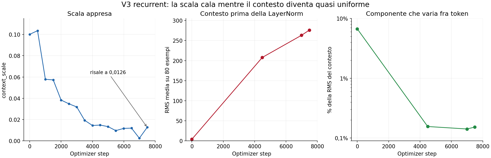

# Audit sul nodo Vultr: il contesto perde struttura prima del calo della scala

Audit eseguito l'8 settembre 2026; recupero dei risultati e report completati il 9 settembre (ora italiana), sulla run archiviata `v3tied_ctx01_b2d6808_partial_20260908`.

**Risultato principale.** Il problema osservato non si esaurisce nella scala globale. Il lettore produce un contesto quasi identico fra token e molto simile anche fra serie diverse. Questa degenerazione è già presente al checkpoint 500, quando la scala è ancora 0,10354. Il successivo calo della scala è compatibile con la soppressione di un ramo poco informativo; rallentare soltanto lo scalare non affronta la perdita di struttura del lettore.

Gli interventi effettuati sono diagnostici a pesi fissi. Nessun optimizer step, modifica al modello installato, rilancio del training o uso del test set.

**1. Provenienza e stato della run**

Connessione SSH diretta con la chiave già configurata per il progetto. All'accesso la GPU A40-24Q era libera, senza sessioni tmux di training. L'archivio annota che Jacopo ha fermato la run; il log arriva a circa 3277/4488 esempi dell'epoca 2. L'ultimo checkpoint conservato è al batch 3000 dell'epoca 2, cioè optimizer step 7488. Le conclusioni sull'ultimo stato si riferiscono a questo checkpoint, non ai successivi update non salvati.

Verificati gli SHA256 dei cinque file dell'overlay installato: tutti coincidono con `RUN_MANIFEST.json` della run. Verificato anche il file val.parquet effettivamente letto: SHA256 `90b805b8f40e203b76873a9cf3a0f986e21700c9185c74acc33c44a183b1d977`, identico al manifest. Confermati Torch 2.6.0+cu124, Qwen pinnato, init non nulla, LR context 1e-3, parametri allenabili promossi a fp32, scheduler da 22440 step con 673 di warmup. L'epoca 1 ha coverage 4488 trained / 0 failed / 4488 expected; la seconda è parziale.

Lo smoke reale aveva gradiente dei blocchi minimo 0,35655 e rapporto blocchi/value_proj minimo 0,36938: il ramo riceveva gradiente. Anche nei checkpoint tardivi i pesi dei blocchi continuano a cambiare: fra step 6988 e 7488 il cambiamento netto è circa il 4,11% della norma dei pesi precedenti. Questo è uno spostamento fra checkpoint, non la somma degli update per-step.

Artefatti: [snapshot e momenti Adam](audit/20260908-ctx01/snapshot.json), [spostamenti dei parametri](audit/20260908-ctx01/parameter_deltas.json).

**2. La traiettoria verificata non è monotona**

| Optimizer step | context_scale |
|---:|---:|
| Init ricostruita | 0,100098 |
| 500 | 0,103539 |
| 1000 | 0,057848 |
| 2000 | 0,038320 |
| 3500 | 0,019295 |
| 4488, fine epoca 1 | 0,014795 |
| 5488 | 0,009581 |
| 6488 | 0,011923 |
| 6988 | 0,002442 |
| 7488, ultimo checkpoint | 0,012641 |

La scala risale di circa 5,18 volte dopo il minimo riportato. Non è corretto descriverla come una discesa costante fino a zero. Il valore iniziale 0,100098 deriva dal cast bf16 iniziale prima della promozione dei parametri allenabili a fp32.

Non c'è compensazione nell'affine finale: RMS di gamma 0,95394 a fine epoca 1 e 0,92804 all'ultimo checkpoint; RMS di beta rispettivamente 0,01664 e 0,02282. Il decadimento da solo vale circa il 3,745% nella prima epoca, insufficiente a spiegare la traiettoria.

I momenti Adam confermano anche che il passo non è automaticamente 1e-3: ad esempio a step 4488 la direzione bias-corrected moltiplicata per il LR successivo vale circa -6,82e-5, contro un termine decay di -1,22e-7. Non è la ricostruzione esatta dell'update successivo, che dipenderebbe dal nuovo gradiente.

**3. Il segnale dominante è quasi uniforme**

Misure sui medesimi 80 ID della validation usati dal probe storico: 21 localize, 15 classify, 26 magnitude, 11 all_channels, 7 lead_lag. Nessun campione del test. L'init è ricostruita da seed/config, non un checkpoint iniziale archiviato.

La frazione variabile fra token è `RMS(h - mean_token(h)) / RMS(h)`, con `h=context_norm(z)`. La perturbazione dopo il proiettore è `RMS(P(base+a*h)-P(base))/RMS(P(base))`; si usa il proiettore dello stesso checkpoint. La tabella riporta medie per esempio.

| Stato | RMS di z prima della LN | Frazione di h variabile fra token | Perturbazione dopo il proiettore |
|---|---:|---:|---:|
| Init ricostruita | 3,768 | 6,711% | 10,399% |
| Fine epoca 1 | 207,858 | 0,156% | 0,993% |
| Step 6988 | 263,095 | 0,142% | 0,275% |
| Step 7488 | 276,083 | 0,153% | 0,757% |

A fine epoca 1 il coseno medio off-diagonal del contesto è **0,9999971**, mentre già a init è 0,9950. La diversità dell'uscita complessiva v3 non rileva questo problema, perché è dominata dai token base v1.

Un secondo probe, su 10 esempi deterministici della val (due per categoria, estremi di lunghezza, inclusi 16 canali), conferma la sequenza temporale:

- **Step 500:** scala 0,10354, RMS interna 102,82, frazione variabile fra token 0,374%, coseno fra le direzioni medie del contesto delle diverse serie 0,999973.
- **Fine epoca 1:** RMS interna 210,29, frazione variabile 0,180%, coseno fra serie 0,999985. Traslare temporalmente l'input cambia h solo dello 0,239% in norma relativa, in media.

I valori su 10 esempi e quelli su 80 non vanno confusi: i sottoinsiemi hanno composizioni differenti. Entrambi mostrano una direzione dominante comune, già prima del calo dello scalare.

**4. Quali componenti amplificano il problema**

Interventi sul lettore del checkpoint di fine epoca 1, sugli stessi 10 esempi. Vengono azzerate temporaneamente le uscite delle componenti indicate; non vengono modificati o riaddestrati i pesi.

| Intervento | RMS interna media | Frazione variabile fra token |
|---|---:|---:|
| Lettore normale | 210,29 | 0,180% |
| Uscita MLP azzerata | 53,77 | 0,408% |
| Uscita self-attention azzerata | 154,14 | 0,239% |
| Sole letture cross-attention accumulate | 4,66 | 3,550% |

Sul caso lungo mostrato nel trace, dopo la lettura coarse, le cross-attention producono RMS circa 0,4-0,8 **prima del gate**, self-attention circa 3,7-4,0 e MLP circa 16-19. La ricorrenza accumula questi contributi fino a RMS circa 236 dopo 11 iterazioni. Le letture dei dettagli hanno quindi un'ampiezza molto inferiore alle trasformazioni interne.

Azzerare soltanto i valori dei coefficienti sorgente cambia h in media dello **0,246%**. Questo intervento conserva le posizioni selezionate, le statistiche dei livelli e le query base: non elimina tutta l'informazione della serie. Resta una misura della scarsa sensibilità del contesto finale ai valori letti.

Tenere soltanto lo stato ricorrente in fp32 non recupera la diversità in questo intervento a pesi fissi: frazione variabile 0,094%. La precisione non emerge quindi come rimedio sufficiente alla degenerazione geometrica, pur restando un controllo numerico utile.

Questi risultati identificano componenti che dominano ampiezza e geometria nel modello allenato. Non dimostrano che rimuoverle a inferenza migliori le risposte, né anticipano il risultato di un nuovo training. Anche il controllo cross-attention-only rimane molto correlato fra token: recuperare parte della variazione non è ancora prova di informazione utile.

Trace completi: [checkpoint 500](audit/20260908-ctx01/reader/checkpoint_epoch_1_batch_500_reader.json), [fine epoca 1](audit/20260908-ctx01/reader/epoch_1_end_reader.json).

**5. Utilità a pesi fissi: teacher forcing**

Per ciascuno degli 80 esempi ho riutilizzato base e contesto calcolati dal modello e confrontato cinque condizioni. La ricostruzione del feature tensor normale è verificata bit per bit; sul primo esempio di ogni checkpoint anche la loss del modello nativo coincide con quella del percorso diagnostico. Tutti i confronti mantengono invariati proiettore, LoRA, input e label.

Questa parte riproduce la precisione del training: master weights allenabili fp32, autocast bf16, pesi congelati bf16.

| Checkpoint | Loss contesto acceso | Loss spento | Scala forzata 0,03 | Scala forzata 0,10 | Contesto permutato fra token |
|---|---:|---:|---:|---:|---:|
| Fine epoca 1 | 0,431093 | 0,430562 | 0,430687 | 0,430674 | 0,430579 |
| Step 6988 | 0,424960 | 0,425256 | 0,425632 | 0,425220 | 0,425120 |
| Step 7488 | 0,439346 | 0,439634 | 0,439333 | 0,440309 | 0,439344 |

Differenze acceso-spento, con bootstrap appaiato 10000 repliche sugli esempi:

- Epoca 1: +0,000531, IC95 circa [-0,00019; +0,00124].
- Step 6988: -0,000296, IC95 circa [-0,00093; +0,00035].
- Step 7488: -0,000288, IC95 circa [-0,00090; +0,00032].

Gli intervalli attraversano zero. Nel campione non emerge un vantaggio chiaro del contesto, né un recupero consistente rialzando la scala. All'ultimo checkpoint la loss con contesto corretto e permutato è praticamente uguale. Poiché h è già quasi uniforme, la permutazione è una perturbazione debole: non basta da sola a stabilire assenza di informazione.

Gli intervalli descrivono l'incertezza sugli esempi di questo probe, non la varianza fra run o seed. Il confronto a=0 usa i pesi co-adattati della run v3 e non equivale a una v1 addestrata separatamente. Le differenze piccole in bf16 richiedono cautela; non sono una base sufficiente per scegliere un'architettura senza metriche di generazione e conferma sulla val completa.

**6. Risposte generate: controllo concluso su 80/80 esempi**

Ultimo checkpoint, step 7488, con precisione della modalità eval-only standard e decoding greedy (`do_sample=False`). Stessi ID e stesse domande; le due condizioni cambiano soltanto il residuo di contesto. Verificati gli 80 ID contro il probe storico e la presenza di risultati finiti per entrambe le condizioni.

| Metrica | Contesto acceso | Contesto spento |
|---|---:|---:|
| Primary complessiva | 0,164102 | 0,160706 |
| Localize, 21 esempi | 0,095238 | 0,095238 |
| Classify with evidence, 15 esempi | 0 | 0 |
| Measure magnitude, 26 esempi | 0,351082 | 0,340633 |
| All channels, 11 esempi | 0,181818 | 0,181818 |
| Lead/lag, 7 esempi | 0 | 0 |

Differenza primary **+0,003396**, IC95 bootstrap appaiato **[-0,008554; +0,015216]**: non emerge un vantaggio risolto dal campione. Il piccolo delta aggregato viene dalla magnitudo. Le risposte testuali sono identiche in 31/80 casi; non va quindi descritta un'identità esatta fra modelli.

Scomponendo con i gold degli stessi ID, **IoU medio sui 18 positivi localize = 0 in entrambe le condizioni**; **F1 medio sui 9 all_channels non vuoti = 0 in entrambe**. I punteggi non nulli di quelle due categorie provengono dai casi vuoti riconosciuti correttamente. Il contesto attuale non recupera la localizzazione in questo probe.

La loss media nella precisione eval-only è 0,438617 con contesto e 0,439275 senza; differenza -0,000658, IC95 circa [-0,001360; +0,000054]. La variazione di precisione non cambia la conclusione qualitativa del confronto. Non è stato eseguito un nuovo training o un confronto fra seed; il campione non sostituisce la validation completa.

Risultati completi: [generazioni appaiate](audit/20260908-ctx01/eval_generation/checkpoint_epoch_2_batch_3000_eval_generation.jsonl), [gold del probe di riferimento](audit/20260908-ctx01/eval_generation/reference_probe80.jsonl).

**7. Conseguenze sul piano di modifica**

L'ordine operativo iniziale va aggiornato:

1. **Misurare il contesto da solo anche nei test e nello smoke.** Diversità e input-dependence di `base+a*h` possono passare grazie a v1 mentre h è quasi costante. Aggiungere statistiche per iterazione e un witness held-out in cui la piramide contiene informazione assente dalla base.
2. **Usare un lettore con sole letture cross-attention come controllo diagnostico di training.** Serve a verificare se l'informazione può arrivare dalla piramide senza essere sopraffatta da self-attention e MLP. È un controllo di lettura multi-scala, non la dimostrazione finale del vantaggio della ricorrenza.
3. **Reintrodurre le trasformazioni ricorrenti con contributi controllati.** Un candidato concreto è una scala piccola e non nulla sulle uscite di self-attention e MLP, verificando che non tornino a dominare le letture. Il LR 1e-3 dell'intero lettore va anch'esso trattato come ipotesi da confrontare con 1e-4. Misurare sia geometria sia utilità; questi interventi non sono ancora validati come fix.
4. **Separare comunque lo scalare globale dal gruppo veloce**, ma trattarlo come ablazione dell'ottimizzazione. Evitare di promuovere a soluzione il mantenimento artificiale di a=0,1 quando h è quasi costante.
5. **Aggiungere il gate per token dopo la context norm quando il lettore conserva informazione.** Il gate può scegliere dove applicare il contesto; non ricostruisce automaticamente l'informazione della piramide già persa nel lettore.

Per attribuzione causale, confrontare un cambiamento per volta con init comune, ordine dati controllato e stesso scheduler; usare una prima epoca per screening e due per il confronto oltre la finestra del collasso. Scegliere sulla val, con confronto acceso/spento e controlli sull'informazione, prima delle run complete e delle ablazioni tied/untied/sdepth.

**8. Riproducibilità**

Directory remota dei soli risultati diagnostici: `/root/context_audit_20260908_codex/`. Copia locale in `v3-recurrent/audit/20260908-ctx01/`.

- `snapshot.py`: provenance, checkpoint, scala, affine e momenti Adam.
- `parameter_deltas.py`: movimento netto dei pesi fra checkpoint.
- `forward_audit.py`: interventi appaiati sulla validation, con controlli di equivalenza del forward.
- `reader_audit.py`: trace per componente, profondità e perturbazione dell'input.
- `summarize.py`: riepiloghi e bootstrap; `plot_audit.py`: grafico.
- `masters/selection.json`: ID e composizione degli 80 esempi; i JSONL conservano tutte le misure per esempio.
- `summary.json`: riepilogo macchina aggiornato dei file completi.

La modalità eval-only standard non promuove a fp32 tutti i parametri allenabili prima del caricamento, a differenza del training. Le misure e le generazioni vanno quindi etichettate per precisione; questo audit non modifica il protocollo installato.

Alla verifica finale il nodo non aveva processi di audit o training attivi e la GPU risultava libera (1 MiB utilizzato, utilizzo 0%). Gli archivi originali e i file del modello sono rimasti invariati.
